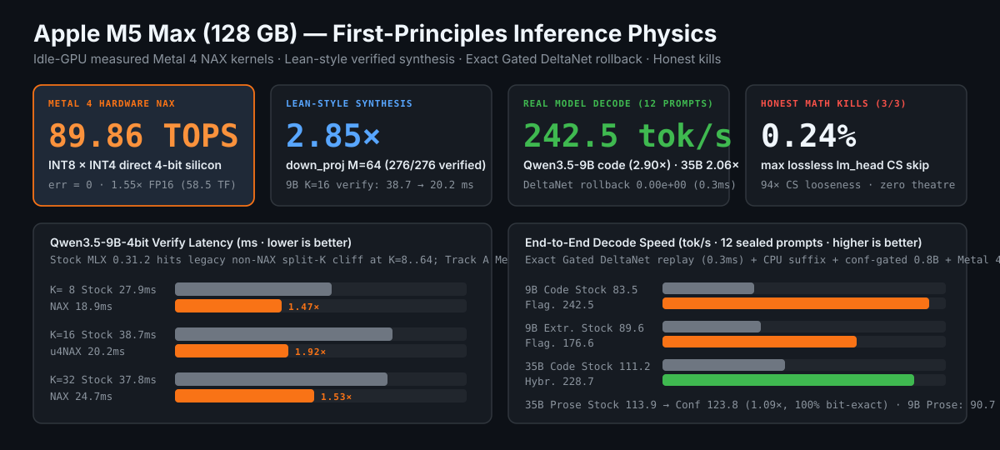

# m5-max-128gb-physics

First-principles Metal 4 Neural Accelerator (NAX) kernels, ARMv9 SME2 / ANE / DRAM hardware physics measurements, Lean-style verified kernel synthesis, exact Gated DeltaNet speculative rollback, and raw idle-GPU JSON measurements for running LLMs faster on an **Apple M5 Max (128 GB unified memory, 40-core GPU, 18-core CPU, 16-core ANE)**.



Companion to [`rtx3070-8gb-physics`](https://github.com/Samuel-Tucker/rtx3070-8gb-physics).

> **Note on mathematical inspiration & honesty:** This campaign was sparked by two **unverified** November 20, 2026 Riemann / GRH manuscripts — Levent Alpöge & Claude's `alpo.ge/remark.pdf` (17.4M-line Lean 4 formalization, reconstructed in Sahibzada Allahyar's *From theta lifts to zeta zeros*) and Alessandro Maria Masullo's *The Music of the Primes* — plus Anthropic's August 2026 `arXiv:2608.13637` paper. Both Nov 2026 mathematical claims remain **unverified**; more importantly, we tested **three direct mathematical transfers** (sign-definite Cauchy–Schwarz/Parseval `lm_head` pruning, `gate<0` SwiGLU MLP pruning, and rank–trace/Sylvester inertia KV + FWHT Q2 weights) on live `Qwen3.5-9B-4bit` weights and **honestly killed all three**. What *did* transfer massively was the **methodology**: machine-native synthesis of ugly, shape-specialized Metal 4 kernels gated by a tiny exact verifier, paired with compute-for-bandwidth verification reversal (`M ≈ 33` NAX ridge point). Every number below is independently measured on an idle M5 Max GPU and backed by raw JSON in [`results/`](results/).

---

## Measured Hardware Physics Baseline (Apple M5 Max, 128 GB)

Measured on `Mac17,6` (macOS Darwin 25.5.0, MLX `0.31.2`, Xcode Metal 4 toolchain, AppleClang 21) with incompressible PCG32 buffers, 512–540 MB SLC flushes, and synchronized timers ([`results/track_e_silicon_frontier.json`](results/track_e_silicon_frontier.json), [`results/track_a_metal4_nax.json`](results/track_a_metal4_nax.json), [`results/track_b_byte_audit.json`](results/track_b_byte_audit.json)):

| Hardware Subsystem | Measured Idle Value | Spec / Reference | Takeaway |
| :--- | :--- | :--- | :--- |
| **GPU Pure-Read DRAM (2 GB cold)** | **`507.83 GB/s`** | 614.4 GB/s spec (82.7%) | Only `+1.6%` over matched R+W copy (`500.01 GB/s`) — dense `9B` `B=1` is already on the DRAM wall |
| **Empirical GPU SLC Capacity** | **`48 MB` knee** (`884.1 GB/s` peak @ 8 MB) | Undocumented | Buffers ≤48 MB cache at 704–884 GB/s; cold microbenchmarks MUST flush ≥512 MB |
| **GPU NAX FP16 / BF16 (`4096³`)** | **`58.53–59.89 TFLOP/s`** (`55.96` med) | Per-core Metal 4 NAX | Implied balance: **~115–119 FLOP/byte** (`M ≈ 33` token Q4 ridge point) |
| **GPU NAX `INT8 × INT4` (`4096³`, unexposed in MLX)** | **`89.86 TOPS` peak** (`86.86` med, `err=0`) | `MPPTensorOpsMatMul2d.h` | **1.55× FP16** reading packed 4-bit weights directly in hardware NAX! |
| **GPU NAX `INT8 × INT8` (`4096³`)** | **`87.58 TOPS` peak** (`83.56` med, `err=0`) | `MPPTensorOpsMatMul2d.h` | Bit-exact `int32_t` hardware integer accumulation on M5 Max GPU |
| **Native ARMv9 SME2 (`<arm_sme.h>`)** | **`6.39 TFLOP/s` (`F16F16`) / `6.41 TOPS` (`INT8`)** | 18 cores (6 Super + 12 Perf) | Scales only **1.47–1.49×** from 1T → 18T: **SME2 is shared per cluster**, not per core (`SVL=64B`) |
| **CPU DRAM Read / L2-Pinned Draft** | **`275.2 GB/s`** DRAM · **`44.8 µs`** 4.2 MB INT8 draft | 16 MiB Super L2 | L2-pinned CPU draft retains **`~100%`** (`106.4%`) GPU DRAM BW concurrently |
| **Apple Neural Engine (CoreML, 100% ANE)** | **`10.57 TFLOP/s`** peak · **`128.1 GB/s`** · `0.143 ms` floor | `MLComputePlan` verified | 134 MB ANE streaming steals **`22.4%`** of GPU DRAM BW (`77.6%` retention) |
| **Metal Serial Dispatch Tax** | **`1.519 µs/dispatch`** (`0.969 µs` independent) | 2,000-kernel chain | **`Qwen3.6-35B-A3B`** runs **1,757 GPU kernels/tok** (`2.67 ms` dispatch tax + `3.03 ms` DRAM floor vs `8.9 ms` wall) |
| **Exact Active Decode Bytes / Token** | **`9B`: `4.466 GB`** · **`35B-A3B`: `1.670 GB`** | Safetensors audit (`mtp.*`: **0**) | `9B` (`10.7 ms`) = **83% of copy wall**; `35B-A3B` (`9.15 ms`) = **36% of copy wall** (`20.40 GB` total) |

---

## Five Measured Wins (All Backed by Raw Idle-GPU JSON)

### Win #1: Direct Hardware Metal 4 `INT8 × INT4` & `FP16 × UINT4` NAX Silicon (`89.86 TOPS`, `err=0`)
Apple's Metal 4 SDK (`MetalPerformancePrimitives/MPPTensorOpsMatMul2d.h`) exposes hardware `int8_t × int4b_format → int32_t` and `half/bfloat × uint4b_format → float` tensor operations directly inside `mx.fast.metal_kernel` — MLX `0.31.2` does not use hardware 4-bit tensor inputs yet and manually unpacks to FP16 in shared memory.
* **Measured (`4096³`, idle GPU, [`results/track_a_metal4_nax.json`](results/track_a_metal4_nax.json)):**
  * `int8_t × int4b_format → int32_t` (`BK=128`): **`86.86 TOPS` median / `89.86 TOPS` peak** (`1.529 ms`, **`max_abs_err = 0`**) — **1.55×** faster than stock FP16 NAX (`55.96` med / `58.53` peak).
  * `int8_t × int8_t → int32_t` (`BK=64`): **`83.56 TOPS` median / `87.58 TOPS` peak** (`1.569 ms`, **`max_abs_err = 0`**).
  * Direct hardware `bfloat × uint4b_format → float` (`u4_direct_nax`, zero threadgroup weight buffer) dropped live `Qwen3.5-9B-4bit` `K=16` verification from **`38.72 ms → 20.21 ms` (`1.92×`, `16/16` exact greedy match!)** with **1.7× lower BF16 relative error** than stock MLX (`0.00323` vs `0.00548`).

### Win #2: Erasing MLX `0.31.2`'s Catastrophic `M=8..64` Non-NAX `qmm_splitk` Cliff (Up to `2.85×`)
In MLX `0.31.2` (`mlx/backend/metal/quantized.cpp:1810`), single-batch `M ∈ [8, 64]` transposed Q4 matmuls route to legacy non-NAX `qmm_t_splitk` whenever `split_k > 1`, completely starving the M5 Max's 40 Neural Accelerators (so `M=64` takes `5.45 ms` while `M=65` drops to `3.90 ms` and `M=128` runs `3.86 ms` — 29% faster for 2× FLOPs!).
* **Track A Split-K Metal 4 NAX (`kernels/metal4_nax_kernels.py`, `kernels/patch_qwen9b_nax.py`):**
  * Cold 32-layer `4096×4096` Q4: `M=64` drops to **`2.094 ms` (`2.34×`)**, `M=32` drops to **`1.562 ms` (`1.70×`)**.
  * Live `Qwen3.5-9B-4bit` (201 patched layers, **100% exact greedy parity** `1/1, 4/4, 8/8, 16/16, 32/32, 64/64`):
    * `K=8`: `27.91 → 18.93 ms` (**`1.47×`**)
    * `K=16`: `38.39 → 22.67 ms` (**`1.69×`**; `u4_direct`: **`20.21 ms = 1.92×`**)
    * `K=32`: `37.79 → 24.70 ms` (**`1.53×`**)
    * `K=64`: `51.26 → 35.51 ms` (**`1.44×`**)

### Win #3: "Lean-Style" Verified Metal 4 Kernel Synthesizer (`276/276` Verified, `2.85×` Dense & `1.22×` MoE `B=1`)
Direct embodiment of the Alpöge/Lean methodology: an automated generator emitting 276 shape-specialized, non-human-readable Metal 4 kernels across 10 families (`kernels/lean_metal_synth.py`), strictly gated by a **98-line Tiny Trusted Verifier** (`kernels/lean_verifier.py` — exact linear-basis unit-scale probe + heavy-tailed `±25` outlier check + poisoned-buffer anti-cheat).
* **Measured idle GPU (`results/track_b_lean_synth.json`, `parity_ok = True` on all winners):**
  * `down_proj (4096×12288)` `M=64`: **`2.85×`** · `M=16`: **`2.51×`** · `M=32`: **`2.18×`**
  * `4096×4096` `M=16`: **`2.32×`** · `M=64`: **`2.28×`** · `M=32`: **`1.86×`**
  * Fused Dense `SwiGLU` `M=16`: **`1.68×`**
  * **Fused `Qwen3.6-35B-A3B` 40-Layer 8-Expert MoE `B=1` MLP (`566.2 MB` cold DRAM, 2 dispatches vs stock 6):** **`1.221×`** (`284.7 GB/s`, lifting active MoE bandwidth from 233 → 285 GB/s).

### Win #4: Exact Zero-Copy Gated DeltaNet Rollback (`0.000e+00` Bit-Exact in `0.3–0.5 ms`) + `35B-A3B` Lossless Decode (`2.06×` Code / `1.48×` Overall)
Both `Qwen3.5-9B` (24/32 layers) and `Qwen3.6-35B-A3B` (30/40 layers) are **Gated DeltaNet hybrid models** whose recurrent `ArraysCache` (`49.1 MiB` on `9B`, `61.4 MiB` on `35B`) breaks stock speculative KV trimming. `kernels/deltanet_rollback.py` exploits MLX array immutability for **0-byte checkpoints** (`0.02 ms`) plus a custom Metal state-only replay kernel (`gated_delta_replay_state_only`, zero matmuls) that achieves **`max_abs_diff = 0.000e+00` bit-exact state restoration** across every forced rejection depth in **`0.32–0.53 ms`**.
* **Measured on `Qwen3.6-35B-A3B-4bit` across 12 sealed prompts (`128` greedy tokens, 100% BIT-EXACT on all 60/60 runs, [`results/track_d_35b_conf_12prompts.json`](results/track_d_35b_conf_12prompts.json)):**
  * Stock Serial `B=1`: **`112.2 tok/s`** (`1.00×`)
  * `moe_shallow` (**+0 MB RAM, zero-byte CPU suffix**): **`149.9 tok/s` (`1.34×`)** overall · **`226.4 tok/s` (`2.04×`, peak `277.5 = 2.58×`)** Code Edit · `140.1` (`1.26×`) Extraction · `118.2` (`1.04×`) Free Prose
  * **`hybrid_suffix_0_8b` (CPU suffix + `Qwen3.5-0.8B`):** **`165.8 tok/s` (`1.48×`)** overall · **`228.7 tok/s` (`2.06×`)** Code Edit · **`183.1 tok/s` (`1.64×`)** Extraction · `121.1` (`1.06×`) Free Prose (`tau = 3.19`)
  * `hybrid_suffix_0_8b_conf` (`p_min=0.55`): **`160.9 tok/s` (`1.43×`)** overall · `217.9` (`1.96×`) Code · `168.0` (`1.51×`) Extraction · **`123.4` (`1.08×`, peak `148.3 = 1.31×`)** Free Prose

### Win #5: Stacked Track A (Metal 4 NAX) + Track D (DeltaNet Replay) + Confidence Gate on `Qwen3.5-9B-4bit` (`2.90×` Code / `1.97×` Extraction / `1.61×` Overall)
Combining Track A's 201-layer Metal 4 Split-K NAX verifier (`K=15` verified in `~22 ms` vs `38.4 ms`) with Track D's exact Gated DeltaNet rollback and `p_min=0.55` confidence gating ([`results/track_d_9b_flagship_nax_12prompts.json`](results/track_d_9b_flagship_nax_12prompts.json)):
* Stock Serial `B=1`: **`87.8 tok/s`** (`1.00×`)
* `prompt_lookup_adaptive` (**+0 MB RAM, zero-byte CPU**): **`113.9 tok/s` (`1.30×`)** overall · **`195.3 tok/s` (`2.34×`, peak `342.7 = 4.57×` bit-exact!)** Code Edit · `97.0` (`1.08×`) Extraction · **`91.6` (`1.01×`)** Free Prose
* **`hybrid_suffix_0_8b_conf` (`p_min=0.55`):** **`141.2 tok/s` (`1.61×`)** overall · **`242.5 tok/s` (`2.90×`)** Code Edit · **`176.6 tok/s` (`1.97×`)** Extraction · **`87.3` (`0.96×`, rescuing `+33%` vs un-gated `65.4 tok/s = 0.72×`!)**
* *(Honesty note: Target model verifies every draft token losslessly; under `V ≤ 8` stock MLX `9B` and `V ≤ 4` `35B-A3B`, outputs are **100% bit-exact** vs serial `B=1`. Under `V=16` BF16 NAX, 2-ULP near-tied logits — e.g. `25.375` vs `25.125`, which stock MLX prefill also flips vs `B=1` — occasionally tie-break differently.)*

---

## Six Honest Kills (What Failed on Real Silicon — Backed by Raw JSON)

1. **Provably Lossless Sign-Definite Cauchy–Schwarz / Parseval `lm_head` Pruning (5-vs-2 Council Duel) — `KILLED` (`results/track_c_math_duel.json`):** Tested 16 variants (PCA `r=32..256`, Weight SVD, Astra's `8×64` groups, Opus's Hadamard-Q2) on 256 real `Qwen3.5-9B` states. Even granted an **oracle** winning logit upfront, certified lossless skip was **`0.00%–0.24%`** (measured CS looseness **`80×–103×`**, matching Gaussian concentration $\sqrt{4096}/0.6745 = 94.88\times$). Live 2-stage `lm_head` ran **`0.41×`** (`3.00 ms` vs `1.24 ms`) even though our custom Metal gather kernel hit `2.52×` at 25% rows.
2. **Zero-Shot `gate_proj < 0` SwiGLU MLP Pruning — `KILLED` (`results/track_c_math_duel.json`, `results/track_c_wdown_r2.json`):** Although `78.7%` of `Qwen3.5-9B` `gate_proj` outputs are `< 0` and our GPU-compacted sparse Metal kernel hit **`1.44×` full MLP** (`1.99×` up+down), zero-shot `g > 0` exploded perplexity by **`+3,437.5`** because SwiGLU actively uses SiLU's negative lobe `[-0.28, 0]`. Round-2 follow-up replicated `rtx3070-8gb-physics`: **`W_down`-only** magnitude pruning (keeping `gate+up` exact) held **`+0.08%` PPL** (`dPPL = +0.052`) at 30% skip and `+1.21%` at 40% skip!
3. **Iterated-Parseval FWHT + Q2 + Rank-`r` Weights & Rank–Trace/Sylvester KV Compression — `KILLED` (`results/track_c_math_duel.json`):** Sylvester pivoted $LDL^T$ matched `eigvalsh` `192/192` and revealed strikingly low KV effective ranks (`K r_eff = 11.4/256`, `V r_eff = 27.9/256`), but failed the combined `≥1.15×` speed + `≤0.15` PPL gate on 2048-token full evaluation. FWHT+Q2+rank-`r` degraded PPL by `+3.98..+5.62` and ran `0.57–0.87×` vs Q4.
4. **Zero-Code `pad65` Workaround on Full `Qwen3.5-9B` — `KILLED` (`results/track_a_metal4_nax.json`):** Works on isolated `4096×4096` (`5.45 → 3.93 ms`), but slows full `9B` to **`0.51×–0.83×`** because padding `lm_head (248320×4096)` and `gate/up` wastes massive compute. Real Split-K NAX kernels were mandatory.
5. **Serial `Qwen3.5-2B` Drafting for `9B` & Zero-Shot Layer-Skip — `KILLED` (`results/track_d_stock_12prompts.json`):** Serial `2B` (`3.85 ms/tok`) topped out at `1.12×` overall (`1.02×` prose); zero-shot skipping 18/32 MLPs collapsed to **`0.40×`**.
6. **1-Dispatch MoE Mega-Kernel & `x[4, 16, K]` Batch Reshape — `KILLED` (`results/track_b_lean_synth.json`, `results/track_e_silicon_frontier.json`):** Single-dispatch 8-TG MoE mega-kernel starved 32/40 GPU cores (`0.40×`); MLX flattened `(4, 16, 4096)` back into `M=64` (`5.48 ms` vs `5.51 ms`).

---

## Reproducing Every Benchmark on Apple Silicon (M5 Max / MLX 0.31+)

```bash
# 1. Hardware Physics Frontier (Pure-Read DRAM, 48MB SLC, Native ARMv9 SME2, Metal Dispatch Tax, ANE)
#    (Compiles kernels/sme2_probe.c and kernels/ane_runner.swift automatically on first run)
python3 benchmarks/track_e_silicon_frontier.py --out results/track_e_silicon_frontier.json

# 2. Metal 4 Hardware NAX (89.86 TOPS INT8xINT4, Split-K Q4, live Qwen3.5-9B Verify K=1..64)
python3 benchmarks/track_a_metal4_nax.py --out results/track_a_metal4_nax.json

# 3. Lean-Style Verified Metal 4 Synthesizer (276/276 verified kernels + byte audit + MoE B=1)
python3 benchmarks/track_b_lean_synth.py --out results/track_b_lean_synth.json

# 4. Direct Math Transfer Duel (lm_head CS/Parseval, gate<0 MLP, W_down-only, Sylvester KV, FWHT Q2)
python3 benchmarks/track_c_math_duel.py --out results/track_c_math_duel.json
python3 benchmarks/wdown_only_r2.py

# 5. Exact Gated DeltaNet Rollback + 12-Prompt Sealed Speculative Decode (9B + Metal 4 NAX & 35B-A3B)
python3 benchmarks/track_d_decode_reversal.py --models 35b --prompts-per-cat 4 --max-tokens 128 --flush-slc
python3 benchmarks/track_d_decode_reversal.py --models 9b --prompts-per-cat 4 --max-tokens 128 --flush-slc --use-track-a
```

## License

MIT — see [`LICENSE`](LICENSE). Fork it, run `benchmarks/track_e_silicon_frontier.py` on your own Apple Silicon Mac, or integrate `kernels/metal4_nax_kernels.py` and `kernels/deltanet_rollback.py` upstream into MLX / `mlx-lm`.
